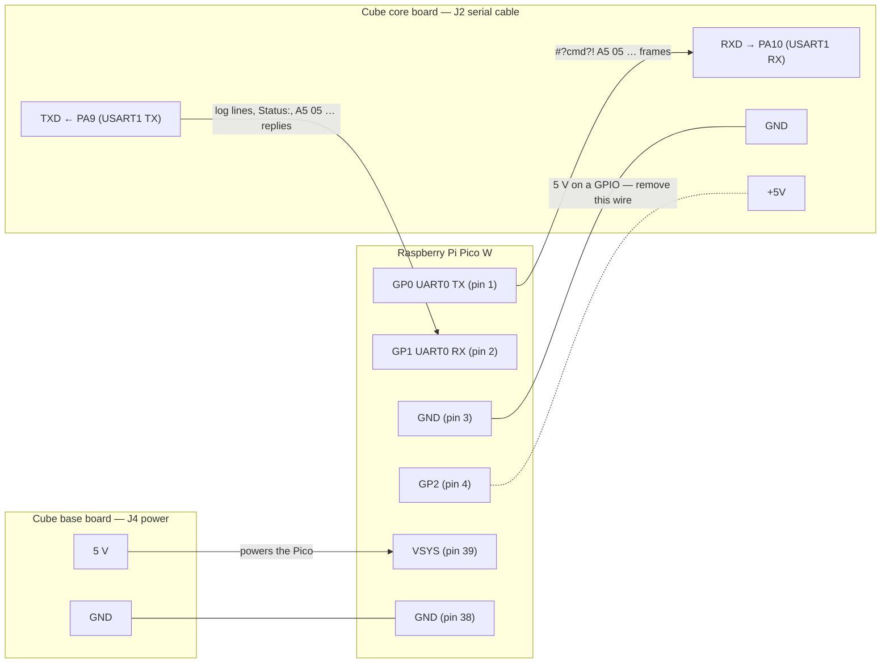
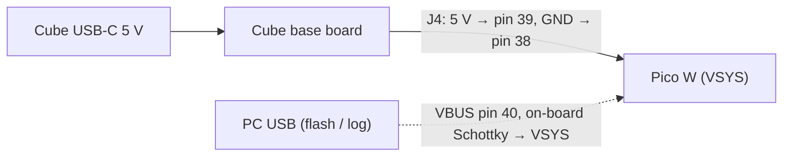

# Pico W ↔ LED cube (GD32F103RET6) wiring

The cube's controller is a GD32F103RET6 on the cube's core board. Its console UART (the MCU's USART1:
TX on PA9, RX on PA10) reaches the Pico through a 4-way cable on Pico pins 1–4; power comes separately
from the cube's base board to Pico pins 39/38. The link runs at 115200 baud, 8N1, 3.3 V CMOS levels on
both sides, so the Pico W connects directly without a level shifter.

The Pico side is UART0 on GP0/GP1 (`internal/controller/pico_w.go`, `internal/component/pin.go`).
The protocol carried on the link is described in
[protocols.md](../documentation/protocols.md#pico--cube-uart). The complete drawing is
[full-schematic.svg](full-schematic.svg); photos of the assembled unit:
[pico-and-display-on-cube-1.jpg](pico-and-display-on-cube-1.jpg) … [-3.jpg](pico-and-display-on-cube-3.jpg).

## Connection diagram

## Pin table

| Pico W pin | Pico W signal | Cable | Other end | Notes |
|---|---|---|---|---|
| 1 | GP0, UART0 TX | J2 (4-way, core board) | RXD → PA10 | Pico → cube |
| 2 | GP1, UART0 RX | J2 | TXD ← PA9 | Cube → Pico |
| 3 | GND | J2 | GND | Signal ground for the UART |
| 4 | GP2 | J2 | +5V | Fills the 4th cable position so the connector sits square, **but it puts the cube's 5 V on GP2** — see below |
| 39 | VSYS | J4 (2-way, base board) | 5 V | Pico supply, 1.8–5.5 V accepted |
| 38 | GND | J4 | GND | Power return |

There is no flow control and no reset line between the boards. The cube's core and base boards share a
ground, so pins 3 and 38 end up on the same net.

> **Warning — GP2 on 5 V.** RP2040 GPIOs are not 5 V tolerant: the absolute maximum on a pad is
> IOVDD + 0.5 V (≈ 3.8 V), above which the ESD diode conducts into the 3.3 V rail. The firmware never
> configures GP2, which is why nothing visibly fails, but it stresses the chip and can pull the Pico's
> 3.3 V rail up. Either pull the 4th contact out of the Pico-side connector shell, cut that wire, or
> move the cable so the +5V position is not populated.

## Power

- The Pico starts and stops with the cube; nothing else needs to be plugged in for normal use.
- For flashing or watching the USB log the PC cable can be plugged in while the cube is on. The Pico has
  a Schottky diode from VBUS to VSYS, but the external 5 V has none: following the
  [Pico W datasheet](../manual/pico-w-datasheet.pdf) powering section, add a Schottky diode in the 5 V
  lead from J4 if both supplies are to be present for long or at different voltages.
- The cube's 5 V supply must have headroom for the Pico W (Wi-Fi peaks ~0.3 A) and the LCD backlight on
  top of the cube's own LEDs.
- Never connect the cube's 5 V to 3V3(OUT) (pin 36) or to any GPIO — which is exactly what the 4th
  serial-cable wire on GP2 currently does.

## Signal behaviour on the link

| Moment | Pico → cube (GP0) | cube → Pico (GP1) |
|---|---|---|
| Idle | high (UART mark) | high |
| Every 1.5 s | `#?Status?!` | `Status:Mode=…,Cartoon=…` |
| Button on the Control tab / desktop command | `#?Key 2?!`, `#?Action 1?!`, `#?Cartoon 3?!`, … | `DoKey2`, `Next Cartoon`, … then a `Status:` reply 200 ms later |
| Cube power-up or reset | — | `Led Cube is starting up`, `T='…'`, `DeviceType=…,DeviceNum=…`, … |
| Show upload | `A5 05 15 11 …` connect, `A5 05 … 20 …` records, `A5 05 02 25 00 …` end ×2 | `A5 05 06 10 …` ready, `A5 05 04 21 …` stored, `Show upload OK` |

The Pico reads GP1 only from its main loop and between display strips; the RP2040 UART FIFO plus
TinyGo's ring buffer absorb the bursts the cube sends at start-up.

## Checklist

1. J2: cube **TXD** → Pico **pin 2** (GP1); cube **RXD** → Pico **pin 1** (GP0); GND → pin 3. Swapping
   TX/RX yields `Cube: NOT RESPONDING` with no cube lines on the Log tab.
2. Remove the 4th wire of J2 (Pico pin 4 / GP2 ↔ cube +5V), or confirm with a meter that it is open.
3. J4: 5 V → pin 39, GND → pin 38. Never to 3V3(OUT).
4. Set the cube to Text mode (both DIP switches on) to play uploaded shows; the Status tab shows the
   current `Mode`.
