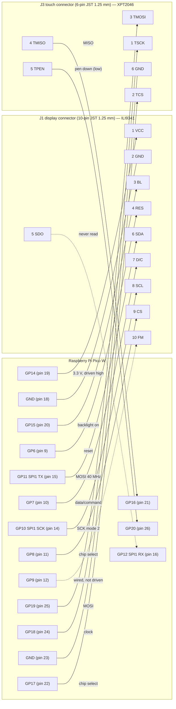

# Pico W ↔ 2.8" ILI9341 / XPT2046 module wiring

The module is the WeAct 2.8" LCD (ILI9341 controller, XPT2046 resistive touch controller, 3.3 V).
It has two JST 1.25 mm connectors: a 10-pin display connector and a 6-pin touch connector. Pin assignments are those used
by the firmware (`internal/component/screen.go`, `internal/component/pin.go`) and match the assembled
unit in [pico-and-display-on-cube-1.jpg](pico-and-display-on-cube-1.jpg) …
[-3.jpg](pico-and-display-on-cube-3.jpg). The complete drawing is [full-schematic.svg](full-schematic.svg).

References: [module schematic](WeAct-2.8InchLCDModule_V10.pdf), [ILI9341 datasheet](../manual/ILI9341.pdf),
[XPT2046 datasheet](../manual/xpt2046-datasheet.pdf), [Pico W datasheet](../manual/pico-w-datasheet.pdf).

## Connection diagram



## Pin tables

### J1 — display connector (10-pin JST 1.25 mm)

| J1 pin | Module label | ILI9341 signal | Pico W GPIO | Pico W pin | Firmware |
|---|---|---|---|---|---|
| 1 | VCC | VCC / IOVCC (3.3 V) | GP14 (output, high) | 19 | "Main Power" |
| 2 | GND | GND | GND | 18 | |
| 3 | BL | Backlight anode | GP15 (output, high) | 20 | `backlight` |
| 4 | RES | RESX, hardware reset (active low) | GP6 | 9 | `reset` |
| 5 | SDO | SPI data out (MISO) | GP12, SPI1 RX | 16 | `SPI1_SDI_PIN`, never read |
| 6 | SDA | SPI data in (MOSI) | GP11, SPI1 TX | 15 | `SPI1_SDO_PIN` |
| 7 | D/C | Data (high) / command (low) | GP7 | 10 | `dc` |
| 8 | SCL | SPI clock | GP10, SPI1 SCK | 14 | `SPI1_SCK_PIN` |
| 9 | CS | CSX, chip select (active low) | GP8 | 11 | `cs` |
| 10 | FM | RDX, parallel-bus read strobe | GP9 | 12 | wired, not driven |

### J3 — touch connector (6-pin JST 1.25 mm)

| J3 pin | Module label | XPT2046 signal | Pico W GPIO | Pico W pin | Firmware |
|---|---|---|---|---|---|
| 1 | TSCK | DCLK | GP18 | 24 | `clk` |
| 2 | TCS | CS (active low) | GP17 | 22 | `cs` |
| 3 | TMOSI | DIN | GP19 | 25 | `din` |
| 4 | TMISO | DOUT | GP16 | 21 | `dout` |
| 5 | TPEN | PENIRQ (low while touched) | GP20 | 26 | `irq` |
| 6 | GND | GND | GND | 23 | |

J1 lands on Pico pins 9–12, 14–16 and 18–20 on the left edge; J3 on pins 21–26 on the right edge. Neither
connector is in Pico pin order, so the wires cross — [full-schematic.svg](full-schematic.svg) marks every
crossing with a hop.

## Pico W header view

```
                           ┌─────[USB]─────┐
   cube RXD   ◄── GP0   1 ─┤               ├─ 40 VBUS
   cube TXD   ──► GP1   2 ─┤               ├─ 39 VSYS  ◄── cube base board 5 V
   cube GND       GND   3 ─┤               ├─ 38 GND   ◄── cube base board GND
   cube +5V (!)   GP2   4 ─┤               ├─ 37 3V3_EN
                  GP3   5 ─┤               ├─ 36 3V3(OUT)
                  GP4   6 ─┤               ├─ 35 ADC_VREF
                  GP5   7 ─┤               ├─ 34 GP28
                  GND   8 ─┤               ├─ 33 GND
   J1-4  RES  ◄── GP6   9 ─┤               ├─ 32 GP27
   J1-7  D/C  ◄── GP7  10 ─┤               ├─ 31 GP26
   J1-9  CS   ◄── GP8  11 ─┤               ├─ 30 RUN
   J1-10 FM   ─── GP9  12 ─┤    Pico W     ├─ 29 GP22
                  GND  13 ─┤               ├─ 28 GND
   J1-8  SCL  ◄── GP10 14 ─┤               ├─ 27 GP21
   J1-6  SDA  ◄── GP11 15 ─┤               ├─ 26 GP20 ◄── J3-5 TPEN
   J1-5  SDO  ──► GP12 16 ─┤               ├─ 25 GP19 ──► J3-3 TMOSI
                  GP13 17 ─┤               ├─ 24 GP18 ──► J3-1 TSCK
   J1-2  GND  ─── GND  18 ─┤               ├─ 23 GND  ─── J3-6 GND
   J1-1  VCC  ◄── GP14 19 ─┤               ├─ 22 GP17 ──► J3-2 TCS
   J1-3  BL   ◄── GP15 20 ─┤               ├─ 21 GP16 ◄── J3-4 TMISO
                           └───────────────┘
```

## Electrical notes

- SPI1 runs at 40 MHz in mode 2 (CPOL = 1, CPHA = 0), the fastest the ILI9341 accepts over short wires.
  Keep the SCL/SDA leads short and of similar length.
- SDO is attached to the SPI1 RX pin because the peripheral needs the pin, but the firmware never reads
  from the panel; the RX FIFO is drained after each DMA transfer.
- FM (RDX) only matters for the parallel interface; it is wired to GP9 so the 10-way cable is fully
  seated, and GP9 is left unconfigured.
- The touch controller is clocked in software by the `xpt2046` driver (no hardware SPI), so its four
  signal pins can be any GPIOs; the firmware uses GP16–GP20. Its ground returns separately on pin 23.
- Pin 4 (GP2) of the cube's serial cable sits on the cube's +5 V: see the warning in
  [pico-w-cube-wiring.md](pico-w-cube-wiring.md#pin-table).
- VCC and BL are switched from GP14/GP15 so the panel starts in a known state. The RP2040 pad current
  is limited (see the Pico W datasheet); if the module's total draw with backlight exceeds it, feed
  VCC and BL from 3V3(OUT) (pin 36) instead and leave GP14/GP15 unconnected.
- The Wi-Fi chip shares DMA with the display: SPI1 transmit is done by DMA channel 1 with chaining
  disabled, because TinyGo's default chains it into channel 0, which the CYW43439 PIO bus uses. See
  [hardware.md](../documentation/hardware.md#peripheral-sharing-on-the-rp2040).
