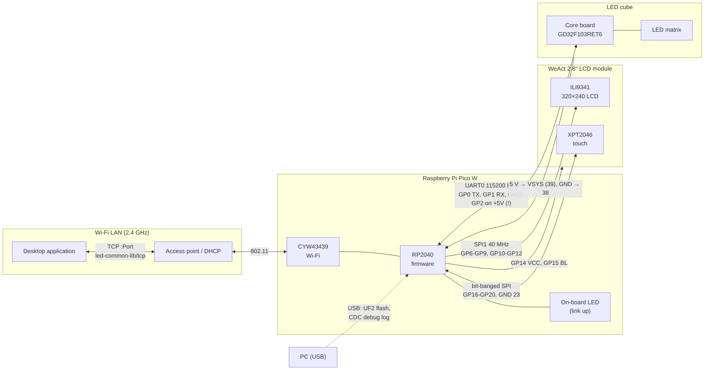
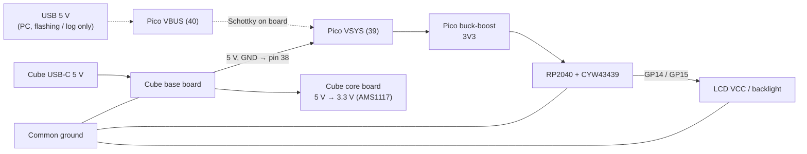

# System overview

The complete wiring in schematic form: [full-schematic.svg](full-schematic.svg).

## Links

| Link | Physical | Protocol | Documentation |
|---|---|---|---|
| Desktop ↔ Pico | Wi-Fi station, TCP server on the Pico | `[ver][type][len u16][payload]` messages | [protocols.md](../documentation/protocols.md#desktop--pico-tcp) |
| Pico ↔ LCD | 10-pin JST 1.25 mm: SPI1 + RES/D-C/CS/FM, VCC and BL from GPIOs | ILI9341 4-wire SPI | [pico-w-display-wiring.md](pico-w-display-wiring.md) |
| Pico ↔ touch | 6-pin JST 1.25 mm: TSCK/TCS/TMOSI/TMISO/TPEN/GND | XPT2046, software SPI | [pico-w-display-wiring.md](pico-w-display-wiring.md) |
| Pico ↔ cube | 4-way UART0 cable (pins 1–4) + 5 V/GND from the base board (pins 39/38) | `#?cmd?!` console, text lines, `A5 05 …` frames | [pico-w-cube-wiring.md](pico-w-cube-wiring.md), [protocols.md](../documentation/protocols.md#pico--cube-uart) |
| PC ↔ Pico | micro-USB | UF2 mass storage, USB CDC serial | [README.md](../../README.md) |

## Power domains

The Pico is powered by the cube's base board and runs whenever the cube does; USB is only attached for
flashing and the debug log. Details: [hardware.md](../documentation/hardware.md#power).
