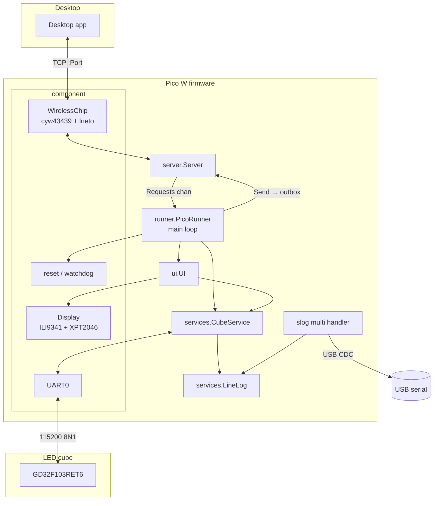
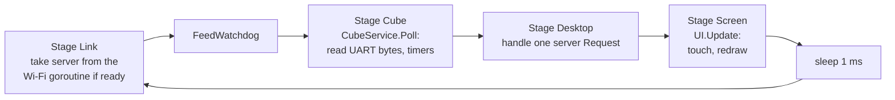

# Software architecture

The firmware is a TinyGo program (target `pico-w`, Go 1.27, TinyGo 0.43) built from
`cmd/rpi_led_com`. The repository root `main.go` is only a task runner (`go run . build|monitor`).

## Package layout

```
cmd/rpi_led_com/main.go      entry point: runner.NewRunner(runner.NewConfig()).Start()
internal/
  runner/      PicoRunner: wiring of all parts, the main loop, desktop message handling, logging setup
               config.json is embedded at build time (Wi-Fi, IP, port, hostname, touch calibration)
  controller/  PicoW: owns the board hardware (Display, cube UART, WirelessChip)
  component/   hardware drivers and board glue
               pin.go          UART/SPI/pin/display/touch constructors, pin modes
               screen.go       Display: strip-buffered ILI9341 drawing + XPT2046 touch reads
               display_spi.go  DisplaySPI: SPI1 DMA transmit without channel chaining
               wireless_chip.go CYW43439 + lneto TCP/IP stack, DHCP, TCP listener
               reset.go        reset cause, watchdog, brown-out, crash record in SRAM4
  services/    CubeService: cube protocol state machine (status polling, commands, uploads)
               LineLog: ring of the last 200 cube/Pico lines
  server/      Server: one desktop connection at a time, TCP message framing, request/outbox channels
  ui/          UI: four tabs (Status, Control, Log, Upload), touch handling and calibration
  common/      colours, millisecond clock, IP parsing, errors, USB structured logger
```

Shared with the desktop application through the module `github.com/Tariomka/led-common-lib`:

- `pkg/communication/tcp` — desktop ↔ Pico message format (see [protocols.md](protocols.md)).
- `pkg/communication/uart` — cube console commands, line parser, upload frames and the upload state
  machine.

External drivers: `soypat/cyw43439` (Wi-Fi chip), `soypat/lneto` (TCP/IP stack), `tinygo.org/x/drivers`
(`ili9341`, `xpt2046`), `tinygo.org/x/tinyfont` (6×12 px monospaced font).

## Component diagram



## Start-up sequence

1. `component.ReadReset()` — first thing, before anything can crash: reads the reset cause from the
   watchdog/chip-reset registers and the SRAM4 record, clears it, enables the brown-out detector and
   configures (but does not start) the watchdog.
2. Logger — `slog.NewMultiHandler` with a structured USB handler (`Debug` and above) and a text handler
   (`Info` and above) whose output goes to the `LineLog` and, when connected, to the desktop as
   `PicoLine` messages. The first log line names the reset cause and the previous run's uptime.
3. `controller.NewPicoW` — creates the display **before** the Wi-Fi chip (the display claims SPI1/DMA
   channel 1 and the pins; the Wi-Fi driver sets up PIO/DMA channel 0), configures UART0 at 115200 baud
   and initialises the CYW43439.
4. `services.NewCubeService` — hooks `OnLine`, `OnProgress`, `OnResult` to forward cube lines and upload
   events to the desktop.
5. `ui.New` — the touchscreen UI; `Display.SetYield` makes the display poll the cube between strips.
6. `Start()`:
   - touch calibration if `config.json` has no valid `Touch` (three crosses, result logged as JSON);
   - first UI draw;
   - Wi-Fi set-up in a goroutine (`join` retries forever with 5 s pauses, then stack configuration, DHCP
     with 3 × 10 s attempts and static-IP fallback, then the TCP listener) — the main loop does not wait
     for it;
   - `component.StartWatchdog()` and the main loop.

## Main loop



Everything that touches the cube, the UI state or the desktop protocol runs on this one goroutine; the
other goroutines only move bytes. The `Stage` is recorded in SRAM4 before each step so that a
watchdog reset can report where the loop stalled (`watchdog timeout in <stage>`).

Timing constants that drive the loop:

| Constant | Value | Where |
|---|---|---|
| Watchdog timeout | 5000 ms | `component.WatchdogTimeout` |
| Status poll interval | 1500 ms | `services.statusInterval` |
| Status reply timeout → "not responding" | 1000 ms | `services.statusTimeout` |
| Status poll after a command | 200 ms | `services.statusAfterCommand` |
| Status poll after a cube restart / upload | 1000 ms | `services.statusAfterStartup` |
| Touch poll interval / minimum press | 25 ms / 30 ms | `ui.touchInterval`, `ui.minPress` |
| Content redraw interval | 100 ms | `ui.redrawInterval` |

## Goroutines and synchronisation

| Goroutine | Started by | Lifetime | Talks to the main loop through |
|---|---|---|---|
| Main loop | `Start` | forever | — |
| Wi-Fi set-up | `Start` | until the listener exists or set-up fails | `links` channel (one `desktopLink`) |
| Wi-Fi packet loop (`handlePackets`) | `WirelessChip.Connect` | forever | lneto stack (internally synchronised) |
| Server accept loop (`Server.Start`) | `startLink` | until `Accept` fails | spawns reader goroutines |
| Connection reader (`Server.serve`) | accept loop, one per desktop connection | until the connection closes | `requests` chan + `handled` chan (rendezvous: the reader blocks until the main loop called `Done`) |
| Connection writer (`Server.write`) | `serve` | until the connection closes | `outbox` chan (256 messages, non-blocking `Send`, drops when full) |

Rules that keep this simple on a single-core TinyGo scheduler:

- Only the main loop reads the cube UART and writes to it; the desktop's messages reach the cube only via
  `Request` handling in `handleRequest`.
- A `Request.Message` payload points into the server's read buffer and is valid only until `Done()`.
- A new desktop connection replaces the current one: the old connection is closed, its reader is
  waited for (`finished`), and the outbox is drained before the new one is served.
- Every goroutine starts with `defer component.Recover("name")`: a panic is printed to USB, stored in
  SRAM4 and the Pico restarts; the next boot logs `crash: <name>: <message>`.

## Data flows

**Cube → desktop and screen.** `CubeService.Poll` feeds every UART byte to `uart.Reader`, which separates
text lines from `A5 05 …` frames. Lines update `CubeState` (`Status:` replies, `Mode=`, `Change Cartoon`,
`T='…'`, `Led Cube is starting up`, …), are appended to the `LineLog` (except `Status:` lines) and sent to
the desktop as `CubeLine`. Frames are passed to the upload state machine while an upload runs.

**Desktop → cube.** `Command` messages become `#?line?!` after validation (`ReBoot` is refused because it
would drop the link mid-upload and confuse the status polling; `?` is not allowed inside a command).
Upload messages drive `CubeService.BeginUpload/WriteUpload/FinishUpload`; progress and the result go
back as `UploadProgress`/`UploadResult`.

**Screen → cube.** The Control tab calls `CubeService.Key/Action/Cartoon`; the same code path as desktop
commands, so the desktop sees the cube's replies too.

**Pico log → everywhere.** `slog` → USB (all levels) and `lineWriter` (Info+) → `LineLog` (shown in cyan on
the Log tab) → desktop as `PicoLine`. On desktop connect, the Pico sends `Hello` followed by the whole
history (up to 200 lines) so the desktop starts with context.

## Display rendering

A full 320×240 RGB565 frame (150 KB) does not fit beside the Wi-Fi stack in the RP2040's RAM, so
`Display` renders through a strip buffer of 320 × 12 px (7680 bytes, one text line high). `Fill` and
`Text` fill the strip and `blit` it with `DrawRGBBitmap8`; after each strip the yield callback polls the
cube so UART bytes are not lost during a long redraw. The UI only redraws the content area when the
cube state, log or upload changed, at most every 100 ms; the tab bar is redrawn on tab change.

`DisplaySPI.Tx` replaces the driver's transmit: it programs DMA channel 1 directly with `CHAIN_TO` set
to itself (chaining off), busy-waits for completion, drains the SPI RX FIFO and clears the overrun flag.
See [hardware.md](hardware.md#peripheral-sharing-on-the-rp2040) for why.

## Networking

- Station mode join with retries; MAC read from the chip.
- `lneto` `xnet.StackAsync`: hostname from config (`pico` if empty), non-zero random seed, 1 TCP + 1 UDP
  port, 4 passive peers (desktop MACs learned from incoming frames), ICMP echo enabled (ping works).
- DHCP requests the configured static IP as a hint; on failure it falls back to the static IP with a /24
  subnet, or fails the link when no IP is configured.
- TCP pool: 2 connections, RX 4096 B, TX 1024 B, 5 s established/closing timeouts, RFC 6298
  retransmission timer (without a policy lneto never retransmits), 1 ms poll back-off.
- `Listener.Accept` polls the pool for ready connections and runs `CheckTimeouts` while waiting.

## Restarts and diagnostics

| Cause (first log line) | Detected by |
|---|---|
| `power-on` | no other flag; SRAM4 record invalid |
| `brown-out (power dropped while running)` | power-on flags but a valid SRAM4 record |
| `reset button` | `CHIP_RESET.HAD_RUN` |
| `forced reset` | `WATCHDOG.REASON_FORCE` without a stored panic (e.g. after flashing) |
| `watchdog timeout in <stage>` | `WATCHDOG.REASON_TIMER` + stored stage |
| `crash: <goroutine>: <panic>` | `REASON_FORCE` + stored panic text (`Crash` triggers the watchdog) |

The line goes to USB, the Log tab and the desktop history, with the previous run's uptime appended.

## Configuration and build

`internal/runner/config.json` is embedded with `go:embed`; the task runner creates an empty file when it
is missing so the build never fails on a fresh clone (the firmware then logs a parse error and runs
without Wi-Fi). Fields: `SSID`, `Password`, `IP`, `Port`, `Hostname`, `Touch{SwapXY,X0,X1,Y0,Y1}`.

```
go run . build            → tinygo build -target pico-w -o bin/rpi_led_com.uf2 ./cmd/rpi_led_com
go run . monitor [port]   → tinygo monitor
make flash                → tinygo flash -target=pico-w -gc=precise -opt=2 -no-debug -size full
```

Copy the UF2 to the `RPI-RP2` drive (BOOTSEL held while plugging in) or use `make flash`.
