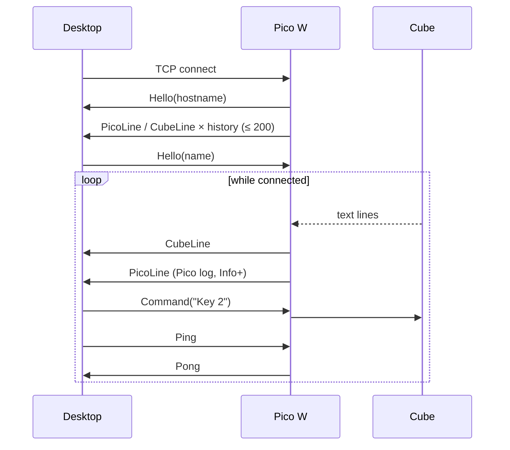
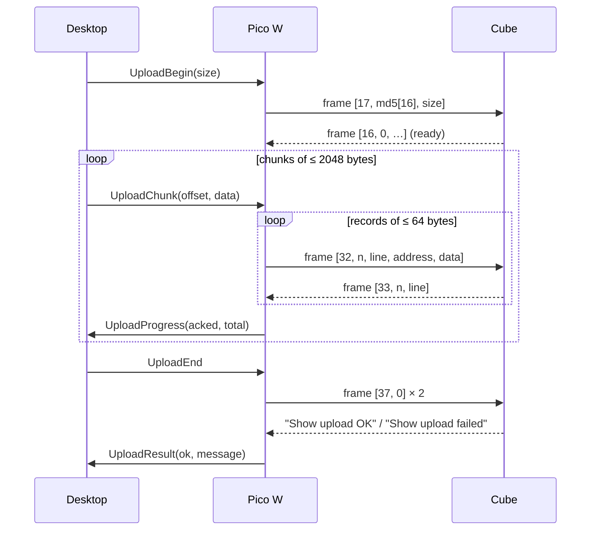

# Protocols

Two protocols meet in the Pico: the desktop link over TCP and the cube link over UART. Both message
formats live in the shared module `github.com/Tariomka/led-common-lib/pkg/communication`
(`tcp` and `uart` packages) so the desktop application and the firmware cannot drift apart.

## Desktop ↔ Pico (TCP)

The Pico listens on `Port` from `config.json` at the IP it got from DHCP (or the static `IP`). One
desktop is served at a time; a new connection replaces the old one. The stream is a sequence of
messages:

```
[version u8 = 1][type u8][length u16 BE][payload: length bytes]
```

The 4-byte header never changes between versions, so a peer can skip a message of an unknown version
(`ErrUnsupportedVersion`) or one that is too large for its buffer (`ErrPayloadTooLarge`) without
losing sync. The Pico's read buffer holds `4 + 2048` bytes, the largest payload it expects.

| Type | Name | Direction | Payload |
|---|---|---|---|
| 0x01 | Hello | both | peer name (Pico sends its `Hostname` right after a connection is accepted) |
| 0x02 | Command | desktop → Pico | console command line, forwarded to the cube as `#?line?!` |
| 0x03 | CubeLine | Pico → desktop | one text line received from the cube (without `\r\n`) |
| 0x04 | PicoLine | Pico → desktop | one Pico log line (`INFO text key=value`) |
| 0x10 | UploadBegin | desktop → Pico | total size u32 BE |
| 0x11 | UploadChunk | desktop → Pico | offset u32 BE, data (≤ 2048 bytes); offsets must be contiguous |
| 0x12 | UploadEnd | desktop → Pico | empty |
| 0x13 | UploadProgress | Pico → desktop | bytes stored by the cube u32 BE, total u32 BE |
| 0x14 | UploadResult | Pico → desktop | ok u8 (1/0), message |
| 0x20 | Ping | both | empty; the Pico answers Pong |
| 0x21 | Pong | both | empty |

### Session



Rules enforced by the Pico:

- `Command` text must be 1..180 bytes and must not contain `?`; `ReBoot` is refused
  (`Command rejected` in the Pico log).
- Commands and uploads are mutually exclusive: a command during an upload fails with `ErrUploadBusy`.
- Messages for the desktop are queued in a 256-entry outbox and dropped when it is full; the Pico never
  blocks on the desktop.
- When the desktop disconnects during an upload, the upload is aborted (no end frame is sent to the
  cube, so it does not load partial data).

### Show upload



The desktop can stream chunks without waiting; the Pico queues them and paces the cube one record at
a time. `UploadProgress` is sent once the cube has acknowledged everything up to the end of the last
chunk received. The Upload tab on the screen shows the same state (`connecting`, `sending`,
`finishing`, `done`, `failed`) and a progress bar; the UI switches to that tab when an upload starts.

## Pico ↔ cube (UART)

UART0, 115200 baud, 8N1, 3.3 V. One byte stream carries three kinds of data in both directions; the
`uart.Reader` separates them and tolerates interleaving.

### Console commands (Pico → cube)

```
#?<command line>?!
```

ASCII, case-insensitive command name, space-separated arguments, at most 180 characters between the
markers. The cube drops a partial command when more than 1 s passes between its bytes. The firmware
uses:

| Command | Sent by | Effect |
|---|---|---|
| `Status` | status poller every 1.5 s, 200 ms after a command, 1 s after a restart | cube answers one `Status:` line |
| `Key <1-7>` | Control tab buttons 1–7, desktop | acts like the physical key (1 previous, 2 next, 3 faster, 4 slower, 5 pause, 6 play model, 7 display off) |
| `Action <code>` | Control tab (`Replay` = 1, `Speed reset` = 5), desktop | runs a key function on this cube only |
| `Cartoon <index>` | Control tab `Play n`, desktop | plays cartoon `index` (0-based) of the current show |
| anything else | desktop `Command` | forwarded verbatim except `ReBoot` |

### Text lines (cube → Pico)

Lines end in `\r\n`; the Pico keeps at most 256 characters per line. Lines that update `CubeState`:

| Line | Field(s) |
|---|---|
| `Status:Mode=…,Cartoon=…,Count=…,Speed=…,PlayModel=…,Pause=…,DisplayOff=…,DeviceNum=…` | whole `Status`; marks the cube `Responding` and ends the poll wait |
| `Mode=<Dynamic\|Audio\|Test\|Text>` | `Mode` |
| `Change Cartoon <n>` | `Cartoon` |
| `Add speed to x.xx` / `Sub speed to x.xx` / `Speed reset to x.xx` | `Speed` (stored in 1/100) |
| `Play Model=<0\|1>` | `PlayAll` |
| `DeviceSuppend:<0\|1>` | `Pause` |
| `Display off=<0\|1>` | `DisplayOff` |
| `T='<type>'` | `Type` |
| `DeviceType=…,DeviceNum=<n>` | `DeviceNum` |
| `Led Cube is starting up` | resets the state, records `StartedAt`, delays the next poll by 1 s |
| `Show upload OK` / `Show upload failed` | upload result while an upload is finishing |

All lines except `Status:` replies go to the Log tab (white) and to the desktop as `CubeLine`. If no
`Status:` reply arrives within 1 s of a poll, the cube is shown as `NOT RESPONDING` until one does.

Uploaded shows only play when the cube is in Text mode (both DIP switches on); the UI shows a hint
whenever `Mode` is something else.

### Upload frames (both directions)

```
A5 05 len payload[len] check 55
```

`len` is 1..179; `check` is the XOR of every other byte of the frame
(`A5 ^ 05 ^ len ^ payload… ^ 55`). A frame with a bad check, or with more than 1 s between its bytes,
is dropped. Payloads used by the firmware (`uart.Upload`):

| Direction | Payload | Meaning |
|---|---|---|
| Pico → cube | `17, md5[16], size u32 BE` | connect; the cube ignores md5 and size |
| cube → Pico | `16, flag, …` | ready; a non-zero `flag` refuses the upload |
| Pico → cube | `32, n, line u16 BE, address u32 BE, data[n]` | store `n` bytes at flash `address`; `address = 0x0800B000 + offset` |
| cube → Pico | `33, n, line u16 BE` | record stored (must echo `n` and `line`) |
| Pico → cube | `37, 0` | end; sent twice |

Constants: `RecordSize` = 64 data bytes per record (the cube drains its 128-byte UART buffer about every
10 ms, so a 77-byte frame stays safely below it), `ShowCapacity` = 160 000 bytes, reply `Timeout` =
1000 ms. A record or the connect frame without a reply in time is sent once more; a second timeout fails
the upload. The end frames are not retried: the upload fails if neither result line arrives.
